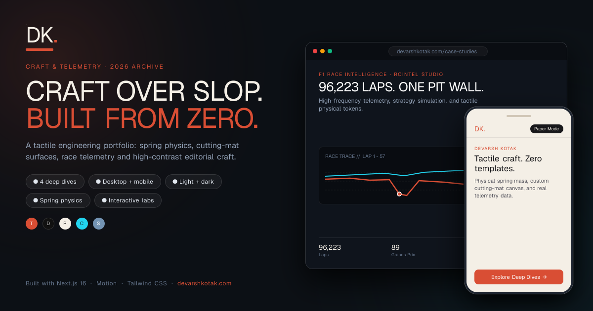

 

## About me

- Product engineer and designer based in **Ahmedabad, India** · BSc Computer Science, **Algoma University** (2025)
- Founder of **RCintel**, a product and brand design studio launching **January 2027**: rebranding, app building and UI/UX for brands, with a specialism in motorsport telemetry and HMI interfaces
- I build end to end: FastF1 ETL pipelines → PostgreSQL → FastAPI → the interface on top
- Currently working through IBM's **Generative AI & Deep Learning** specialization
- I watch every Formula 1 race, and most of my side projects end up being about it

## Featured work

<table>
<tr>
<td width="50%" valign="top">

### [RI360 · RaceIntel360](https://github.com/Devarsh-44/R1360)
Every F1 season since 2019, read like a pit wall. Race traces, tyre strategies, a pace model per race, and a strategy lab. Built from **172,337 timing laps across 157 races**, updated the morning after every Grand Prix. **Launching as an app.**

</td>
<td width="50%" valign="top">

### [Safal Vidyalaya](https://github.com/Devarsh-44/safal)
Client rebrand of a K–12 school website: from a generic template to a bilingual, notebook-inspired design system with motion. Designed first, then built end to end.

</td>
</tr>
<tr>
<td width="50%" valign="top">

### [Hypercar Pit-Wall Telemetry](https://github.com/Devarsh-44/cadillac-jota-telemetry)
Interactive pit-wall telemetry interface concept for an endurance-racing Hypercar programme. HMI design for split-second decisions.

</td>
<td width="50%" valign="top">

### [Klyte landing page](https://github.com/Devarsh-44/klyte-trial)
Product landing page concept with a 3D can, label art and studio lighting generated entirely in code.

</td>
</tr>
</table>

**Also built:** an n8n + OpenAI agent that scores job postings against my profile and logs them to Google Sheets, and a freelance wedding RSVP platform on Google Apps Script + Netlify.

## Tech stack

   
  

  
  
  
  
  

## GitHub stats

  
  

  

